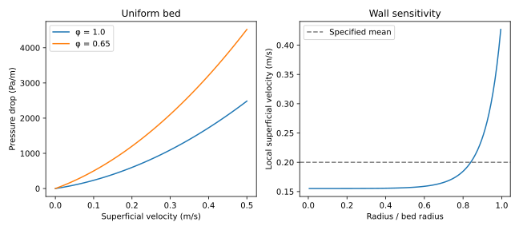

# Yug Bhushan

I study chemical engineering at IIT Delhi. I like problems where I can start with a balance on paper and then use a few lines of Python to see what changes when I vary an assumption. I’m looking for a summer research internship where I can work on a model and compare it with measurements from the lab.

### What happens near the wall of a packed bed?

For a term paper with Parikshit and Shrish Kumar, we looked at how particle shape affects the pressure needed to push fluid through a bed. One detail I like about this problem is that knowing the average flow tells you very little about where the fluid goes. If the packing leaves more open space near the wall, more of the flow can pass through that part of the bed.

The Python example below plots the two effects separately. On the left, the less spherical particles give a higher pressure drop at the same flow speed. On the right, the model predicts faster flow near the wall. Both plots use illustrative inputs.

[Our term paper](https://github.com/yugbhushan/yugbhushan/blob/main/papers/packed-bed-transport/report.pdf) · [Python model](https://github.com/yugbhushan/yugbhushan/blob/main/code/packed_bed.py) · [Assumptions behind the plots](https://github.com/yugbhushan/yugbhushan/blob/main/projects/packed-bed-transport.md)

### Other projects

- **Gas sensors.** I used readings from 16 sensors to distinguish six gases with PCA and a Random Forest. The question I’d like to test further is how well a classifier trained on earlier measurements holds up as the sensors drift. [Paper and code](https://github.com/yugbhushan/yugbhushan/tree/main/papers/gas-sensor-monitoring)
- **Disc brakes.** I compared cast iron and carbon-ceramic rotors in COMSOL during a sudden stop. The accompanying Python example follows heat through the rotor thickness and checks how much energy is stored or lost as the disc cools. [Paper and code](https://github.com/yugbhushan/yugbhushan/tree/main/papers/brake-thermal-analysis)
- **Rainfall.** I fitted separate least-squares models for Delhi, Chennai and Agra. The example compares a next-day forecast with the simple guess that tomorrow gets the same rainfall as today. [Paper and code](https://github.com/yugbhushan/yugbhushan/tree/main/papers/rainfall-prediction)

Outside class I play basketball for my hostel. You can reach me at [yugbhushan.iitd@gmail.com](mailto:yugbhushan.iitd@gmail.com).

[CV](https://github.com/yugbhushan/yugbhushan/blob/main/CV.md) · [LinkedIn](https://www.linkedin.com/in/yug-bhushan-532a8136b/) · [Run the examples](https://github.com/yugbhushan/yugbhushan/blob/main/REPRODUCING.md)
