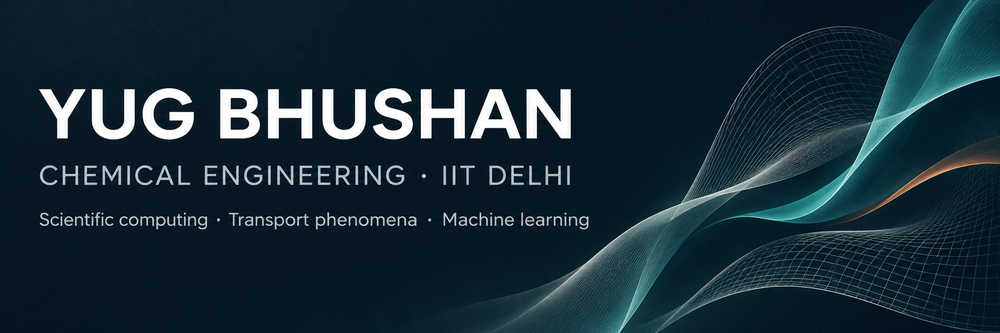

  

  <a href="#selected-projects">Selected work</a> &nbsp; / &nbsp;
  <a href="#technical-toolkit">Technical toolkit</a> &nbsp; / &nbsp;
  <a href="https://www.linkedin.com/in/yug-bhushan-532a8136b/">LinkedIn</a> &nbsp; / &nbsp;
  <a href="mailto:yugbhushan.iitd@gmail.com">Email</a>

## About

I'm **Yug Bhushan**, a Chemical Engineering undergraduate at **IIT Delhi**. I work at the intersection of **physical modelling, numerical methods, and machine learning**, with projects in process monitoring, momentum transport, heat transfer, and environmental data analysis.

I'm interested in research that connects engineering fundamentals with computational tools—and in comparing model predictions with experimental observations.

## Selected projects

<table>
<tr>
<td width="50%" valign="top">

### Gas-sensor process monitoring
**Machine learning · Process monitoring**

PCA and Random Forest classification using **13.9K+ observations**, 16 sensors, and six gas classes.

**97.8% accuracy · 97.6% F1 · 0.99 ROC-AUC** on the reported held-out test set.

[Explore the project →](projects/gas-sensor-monitoring.md)

</td>
<td width="50%" valign="top">

### Packed-bed momentum transport
**Transport phenomena · Python**

Pressure-drop modelling with the Ergun equation, particle sphericity, and the Benenati–Brosilow wall-channeling correlation.

**Focus:** how particle shape and near-wall flow influence bed design.

[Explore the project →](projects/packed-bed-transport.md)

</td>
</tr>
<tr>
<td width="50%" valign="top">

### Disc-brake thermal analysis
**COMSOL · Finite element analysis**

Transient rotor heating during panic braking, including **conduction, convection, and radiation**.

**Comparison:** Gray Cast Iron and Carbon-Ceramic (SiC) rotor temperature response.

[Explore the project →](projects/brake-thermal-analysis.md)

</td>
<td width="50%" valign="top">

### Rainfall prediction in India
**Regression · Scientific computing**

Matrix least-squares regression using meteorological data for **Delhi, Chennai, and Agra**.

**Reported R = 0.95–0.99**, evaluated alongside normalised mean squared error.

[Explore the project →](projects/rainfall-prediction.md)

</td>
</tr>
</table>

[Browse the project portfolio](projects/README.md) · [Run all four examples](REPRODUCING.md) · [Python source](code) · [Generated figures and results](results)

Each project page distinguishes the original CV findings from the newly implemented example. The gas and rainfall demos use seeded synthetic data by default. The packed-bed and brake models use documented illustrative parameters.

## Technical toolkit

| Area | Tools and methods |
| :--- | :--- |
| Scientific computing | Python, C++, C, MATLAB; least squares and numerical analysis |
| Data analysis | NumPy, Pandas, Matplotlib; regression and statistical validation |
| Machine learning | Scikit-learn; PCA, Random Forest classification, model evaluation |
| Engineering simulation | COMSOL, Aspen HYSYS, Autodesk Inventor, ChemSketch |

Additional tools and academic foundation

**Additional tools:** PyTorch, TensorFlow, HTML, Java, Visual Basic, Photoshop, Illustrator.

**Coursework:** Transport Phenomena; Chemical Engineering Thermodynamics; Material and Energy Balances; Numerical Analysis for Chemical Engineers; Probability and Statistics; Linear Algebra and Differential Equations.

## Education & involvement

**Indian Institute of Technology Delhi** — Chemical Engineering undergraduate.

- **Academic recognition:** top 1% in JEE Advanced and top 0.1% in JEE Main; qualified NSEC and NSEP in the top 1 percentile.
- **Leadership:** alumni relations, Entrepreneurship Development Cell, and Office of Career Services at IIT Delhi.
- **Beyond academics:** basketball and a silver medal in the Freshers General Championship.

## Research & collaboration

I'm interested in undergraduate research opportunities in **computational chemical engineering, process monitoring, and heat and momentum transport**, including projects with experimental components.

**Contact:** [yugbhushan.iitd@gmail.com](mailto:yugbhushan.iitd@gmail.com) · [LinkedIn](https://www.linkedin.com/in/yug-bhushan-532a8136b/)
