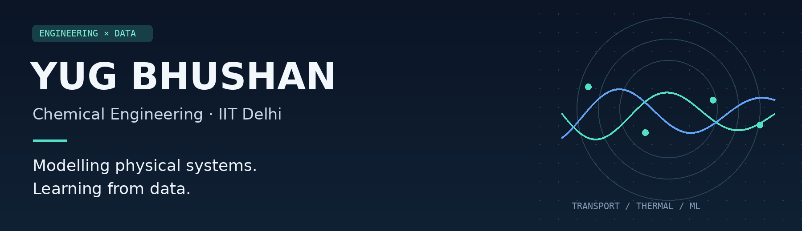

  

  <a href="mailto:yugbhushan.iitd@gmail.com">Email</a> &nbsp;·&nbsp;
  <a href="https://www.linkedin.com/in/yug-bhushan-532a8136b/">LinkedIn</a> &nbsp;·&nbsp;
  <a href="#selected-projects">Projects</a>

### Hi, I'm Yug.

I'm a **Chemical Engineering undergraduate at IIT Delhi**, interested in connecting transport phenomena, numerical modelling, and machine learning to practical engineering problems.

My projects span gas-sensor classification, packed-bed pressure drop, transient heat transfer, and rainfall prediction. I enjoy working through the physics behind a model and using data to evaluate its behaviour.

**Research interests:** computational chemical engineering · process monitoring · heat and momentum transport · scientific computing

## Selected projects

<table>
<tr>
<td width="50%" valign="top">

### 01 / Chemical process monitoring
**Machine learning · Gas sensors**

Processed **13.9K+ readings** from a 16-sensor array spanning six gas classes. Combined PCA with a Random Forest classifier to study sensor drift and classification.

**Reported test performance:** 97.8% accuracy · 97.6% F1 · 0.99 ROC-AUC

[Read the project overview →](projects/gas-sensor-monitoring.md)

</td>
<td width="50%" valign="top">

### 02 / Momentum transport in packed beds
**Transport phenomena · Python**

Developed a pressure-drop model based on the Ergun equation, extended it using particle sphericity, and examined wall channeling with the Benenati–Brosilow correlation.

**Reported comparison:** approximately 190% higher ΔP/L for crushed catalyst at sphericity 0.65 versus spherical beads under the studied conditions.

[Read the project overview →](projects/packed-bed-transport.md)

</td>
</tr>
<tr>
<td width="50%" valign="top">

### 03 / Transient brake thermal analysis
**COMSOL · Finite element analysis**

Modelled automotive disc-brake heating during panic braking, accounting for **conduction, convection, and radiation**. Compared Gray Cast Iron and Carbon-Ceramic (SiC) rotors.

**Focus:** transient temperature response and material-dependent thermal stability.

[Read the project overview →](projects/brake-thermal-analysis.md)

</td>
<td width="50%" valign="top">

### 04 / Rainfall prediction across Indian cities
**Python · Multilinear regression**

Used meteorological data to model rainfall in **Delhi, Chennai, and Agra**. Implemented matrix least squares and evaluated results with NMSE and correlation.

**Reported correlation:** R = 0.95–0.99 across the three cities.

[Read the project overview →](projects/rainfall-prediction.md)

</td>
</tr>
</table>

## Tools I work with

| Area | Tools |
| :--- | :--- |
| Scientific programming | Python, C, C++, MATLAB |
| Data analysis & visualisation | NumPy, Pandas, Matplotlib |
| Machine learning | Scikit-learn, PyTorch, TensorFlow |
| Engineering modelling | COMSOL, Aspen HYSYS, Autodesk Inventor, ChemSketch |
| Additional programming | HTML, Java, Visual Basic |

## Beyond the model

- **Academic recognition:** top 1% in JEE Advanced and top 0.1% in JEE Main.
- **Community:** alumni relations, entrepreneurship events, and campus career-services volunteering at IIT Delhi.
- **Outside academics:** basketball and a silver medal in the Freshers General Championship.

## Let's connect

I'm interested in research opportunities involving **computational modelling, data analysis, and chemical engineering**, including projects that connect simulations with experiments.

[Email me](mailto:yugbhushan.iitd@gmail.com) · [Connect on LinkedIn](https://www.linkedin.com/in/yug-bhushan-532a8136b/)
