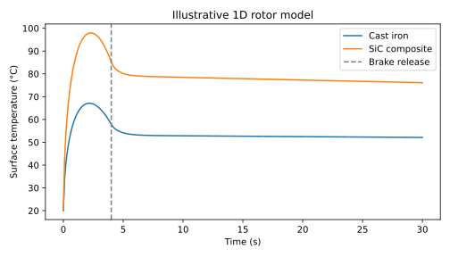

# Transient Thermal Analysis of Disc Brakes

**Heat transfer / Finite element analysis / COMSOL**  
February 2026

[Profile](../README.md) · [All projects](README.md)

[Download source ZIP](https://github.com/yugbhushan/yugbhushan/raw/refs/heads/main/sources/brake-thermal-analysis/brake-thermal-analysis.zip) · [Editable notebook](../sources/brake-thermal-analysis/brake.ipynb) · [COMSOL Java source](../native/comsol/DiscBrakeStudy.java)

## Engineering question

How does rotor material influence transient temperature response during panic braking?

## Simulation scope

| Component | Scope |
| :--- | :--- |
| Simulation | Transient finite element analysis in COMSOL |
| Heat-transfer modes | Conduction, convection, and radiation |
| Material comparison | Gray Cast Iron and Carbon-Ceramic (SiC) |
| Loading scenario | Panic braking |
| Main response | Peak temperature and transient heating |

## Original project work

1. Built the transient thermal finite element model.
2. Included the three heat-transfer modes in the analysis.
3. Compared the temperature response of the two rotor materials under braking.
4. Assessed their relative thermal stability under the modelled load.

## Reported finding

The project comparison indicated superior thermal stability for the SiC rotor under the studied loading conditions. Numerical peak temperatures were not included in the supplied project summary.

## Engineering relevance

The project applies heat-transfer modelling to a materials-selection problem under rapid thermal loading.

## Reproducible implementation

### Run the transient heat-transfer model

[Python finite element implementation](../code/brake.py) · [Installation](../REPRODUCING.md) · [Output tables](../results/brake)

```sh
python code/brake.py
```

This reconstruction resolves conduction through a **10 mm half-thickness** of rotor, per square metre of rubbing surface. The centre plane is insulated by symmetry. The rubbing surface receives a triangular heat-flux pulse that decreases from 600 kW/m² to zero over four seconds. The surface simultaneously loses heat by convection and radiation to an environment at 20 °C. The simulation continues through cooling to 30 seconds.

| Scenario input | Gray cast iron | Illustrative SiC composite |
| --- | ---: | ---: |
| Density, kg/m³ | 7,200 | 2,500 |
| Heat capacity, J/(kg·K) | 500 | 800 |
| Thermal conductivity, W/(m·K) | 52 | 35 |
| Initial temperature, °C | 20 | 20 |

Both scenarios use a convective coefficient of 35 W/(m²·K) and emissivity 0.8. These are illustrative constant properties and loading assumptions. The CV comparison used a COMSOL model whose original material definitions and geometry are unavailable.

### Numerical method and checks

Linear finite elements discretise the heat equation through the thickness. A lumped capacity matrix stores thermal energy at the nodes. Backward Euler advances temperature in time, and Newton iteration resolves radiation using absolute temperature in kelvin. The pulse input is integrated over each step, including the brake-release transition.

The 30-element, 0.1-second solution peaks at **67.12 °C for cast iron** and **97.98 °C for the SiC scenario**. Doubling the mesh resolution and halving the time step changes these peaks by about 0.09 and 0.21 °C. The integrated heat balance compares incident heat with stored energy and surface losses. The applied pulse contributes 1.20 MJ/m².



The higher SiC peak here depends on the chosen density, conductivity and heat capacity. Thermal stability can also depend on allowable service temperature, gradients and stress. A comparison with the historical COMSOL finding would require the original loading, properties, contact area and criterion for stability. This reduced model omits radial and circumferential gradients, pad contact dynamics and rotation.

For background on a full geometric brake model, see [COMSOL’s Heat Generation in a Disc Brake](https://www.comsol.com/model/heat-generation-in-a-disc-brake-102).
