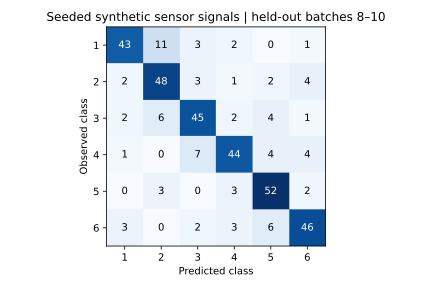

# Gas-Sensor Process Monitoring

**Machine learning / Chemical process monitoring**  
July–October 2025

[Profile](../README.md) · [All projects](README.md)

[Download source ZIP](https://github.com/yugbhushan/yugbhushan/raw/refs/heads/main/sources/gas-sensor-monitoring/gas-sensor-monitoring.zip) · [Editable notebook](../sources/gas-sensor-monitoring/gas.ipynb)

## Research question

How can multivariate gas-sensor readings be used to distinguish gas classes while accounting for changes in sensor response over time?

## Project scope

| Component | Scope |
| :--- | :--- |
| Observations | More than 13,900 multivariate readings |
| Sensor array | 16 sensors |
| Classification task | Six gas classes |
| Dimensionality reduction | Principal component analysis (PCA) |
| Classifier | Random Forest |

## Original project work

1. Processed the multivariate sensor readings for classification.
2. Applied PCA to reduce the dimensionality of the sensor data.
3. Trained a Random Forest classifier in the context of sensor drift.
4. Evaluated classification performance on held-out test data and identified key sensor features.

## Reported results

| Test metric | Value |
| :--- | ---: |
| Accuracy | 97.8% |
| F1-score | 97.6% |
| ROC-AUC | 0.99 |

## Engineering relevance

The project connects chemical process monitoring with statistical feature extraction and machine learning. Its central theme is using high-dimensional sensor signals to support class identification.

## Reproducible implementation

### Run the classifier

[Python implementation](../code/gas.py) · [Installation](../REPRODUCING.md) · [Output tables](../results/gas)

```sh
python code/gas.py
python code/gas.py --data path/to/extracted/UCI224 --out runs/gas-uci
```

The default example generates 1,200 synthetic observations from six class centres, sensor noise and a batch-dependent drift term. Batches 1–7 supply 840 training observations. The remaining 360 observations come from later batches. This split asks whether the classifier generalises across a change in acquisition time.

Standardisation and PCA are fitted exclusively on the training batches. PCA retains enough components to explain 95% of training variance. A 200-tree Random Forest predicts the held-out labels. The confusion matrix counts predicted classes by observed class. Its off-diagonal cells identify which gases the model confuses. Macro F1 weights each class equally, while macro one-vs-rest ROC-AUC uses the predicted class probabilities.



**Example output.** The synthetic run retains 15 components and yields 77.22% accuracy, 0.772 macro F1 and 0.952 macro ROC-AUC. These values describe the demonstration above. The historical held-out scores at the top of this page describe the CV project and its original evaluation.

### Run on observed gas data

One compatible benchmark is the [UCI Gas Sensor Array Drift Dataset, dataset 224](https://archive.ics.uci.edu/dataset/224/gas). Download and extract the original batch1.dat through batch10.dat files together. The reader handles the one-based sparse feature indices and 128 features, eight per sensor. It preserves batch identity throughout fitting and scoring. The public-data option has been format-tested with generated fixtures. An observed-data score requires running it on the downloaded UCI files.

For a new study, compare a classifier trained on uncompressed features with the PCA pipeline on the same chronological split. Keep the last batches untouched during model selection. This would separate the effect of dimensionality reduction from the effect of drift.
