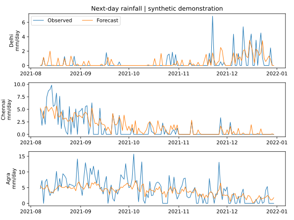

# Rainfall Prediction Across Three Indian Cities

**Scientific computing / Multilinear regression / Python**  
November 2025

[Profile](../README.md) · [All projects](README.md)

## Modelling question

How can meteorological observations be used in a regression model of rainfall across Delhi, Chennai, and Agra?

## Project scope

| Component | Scope |
| :--- | :--- |
| Cities | Delhi, Chennai, Agra |
| Data | Meteorological records containing temperature, humidity, wind speed, pressure, and rainfall |
| Model | Multilinear regression |
| Estimation | Matrix least squares in Python |
| Evaluation | Normalised mean squared error (NMSE) and correlation coefficient (R) |

## Original project work

1. Built rainfall models from the meteorological data.
2. Implemented matrix least squares for coefficient estimation.
3. Compared predictions and observations using NMSE and R.
4. Examined the results across all three cities.

## Reported result

The project reported **R = 0.95–0.99** across the three cities. R is a correlation coefficient and should not be interpreted as percentage accuracy.

## Engineering relevance

The project combines environmental data analysis, linear algebra, and statistical model evaluation.

## Reproducible implementation

### Run the forecasting example

[Python implementation](../code/rainfall.py) · [Installation](../REPRODUCING.md) · [Output tables](../results/rainfall)

```sh
python code/rainfall.py
python code/rainfall.py --data observations.csv --out runs/rainfall-observed
```

The default run uses two years of **synthetic** daily weather per city. The city names label three demonstration series. They do not make these observations representative of the cities' actual climates.

For an observed-data run, provide one CSV row per city and calendar day. Use these column names and units.

| Column | Meaning |
| --- | --- |
| city, date | Delhi, Chennai or Agra and an ISO calendar date |
| temp_c, humidity_pct | Temperature in °C and relative humidity in percent |
| wind_ms, pressure_hpa | Wind speed in m/s and pressure in hPa |
| rain_mm | Daily precipitation in mm |

### Forecast definition

Each row supplies today's weather, including today's rainfall. The target is rainfall on the **next calendar day**. Pairs separated by missing dates are excluded. Duplicate city/date rows are rejected. Each city needs at least 40 usable next-day pairs. A separate model is fitted to the earliest 80% of pairs per city, then scored on the latest 20%.

NumPy's least-squares solver estimates the intercept and five weather coefficients. Predictions below zero are clipped to zero. The persistence baseline predicts tomorrow's rainfall as today's rainfall. RMSE has units of mm/day. NMSE divides mean squared error by the population variance of test observations. Correlation measures co-movement, while RMSE measures magnitude error.

| Synthetic holdout | R | Model RMSE, mm/day | Persistence RMSE, mm/day |
| --- | ---: | ---: | ---: |
| Delhi | 0.539 | 0.938 | 1.460 |
| Chennai | 0.755 | 1.518 | 2.144 |
| Agra | 0.714 | 2.770 | 3.740 |



The model beats persistence on each synthetic series. Real forecasting skill depends on an observed dataset, its date range, station provenance and availability of each predictor at prediction time. The original project’s correlations are reported separately above.
